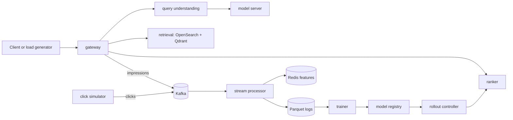

# BharatSearch

A Hinglish- and vernacular-aware commerce search engine with a real-time
learning loop, plus a forecast-driven predictive autoscaler that survives
IPL-style traffic spikes. Built local-first on a developer machine with no
cloud account.

## Architecture



## Quickstart

Prerequisites: Docker, Python 3.12+, `uv`, `make`.

```bash
# 1. Configure environment
cp .env.example .env   # review PROFILE (lite | standard | full)

# 2. One-command setup (environment, models, sample slice)
make setup

# 3. Start the stack
make up

# 4. Smoke test
make smoke

# 5. First search
curl -X POST http://localhost:8000/v1/search \
  -H 'Content-Type: application/json' \
  -d '{"query":"fone cover sasta","session_id":"s1"}'

# 6. Stop the stack
make down
```

## Makefile targets

| Target | Purpose |
|--------|---------|
| `make setup` | Create environment, download models/data, build sample slice |
| `make up` / `make down` | Start/stop the Compose stack for `$(PROFILE)` |
| `make clean` | Stop stack and remove volumes |
| `make smoke` | End-to-end check on a tiny fixture |
| `make test` | Unit + integration tests |
| `make lint` | ruff check + format check |

## Hardware profiles

| Profile | GPU | Model | Catalog | Use |
|---------|-----|-------|---------|-----|
| lite | no | stub / small quantized on CPU | ~60k products | full pipeline on a laptop |
| standard | consumer GPU / Apple Silicon | 7-8B quantized | larger slice | demo profile |
| full | NVIDIA GPU | vLLM | full catalog | final benchmarks |

Set `PROFILE` in `.env` before `make up`.

## Reproducing results

Pinned versions, lockfiles, and seeded data regeneration via `make setup` and
`make eval`. Result tables regenerate from scripts.

## Limitations

Queries are synthetic and the gold set has a single reviewer; clicks are
simulated; autoscaler results come from a calibrated stub on one machine; the
catalog is English-only. Reported gains hold within those limits.

## License

See dataset and model licenses before use; cite the dataset in the README.
Never commit dataset files or model weights — scripts download them.
