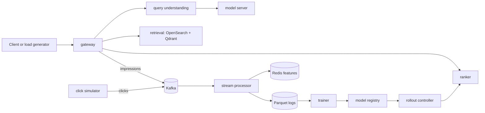

# BharatSearch

A Hinglish- and vernacular-aware commerce search engine with a real-time
learning loop, plus a forecast-driven predictive autoscaler that survives
IPL-style traffic spikes. Built local-first on a developer machine with no
cloud account.

## Architecture



## Headline results

| Area | Metric | Result | Report |
|------|--------|--------|--------|
| Search | BM25 vs hybrid NDCG@10 by slice | See slice table | `docs/benchmarks/2026-11-05.md` |
| Autoscaler | Forecaster pinball loss (matchday) | Holt 9.14 vs persistence 6.90 | `docs/benchmarks/autoscale-2026-11-05.md` |
| Autoscaler | Coverage @ tau=0.9 (matchday) | Holt 0.960 | `docs/benchmarks/autoscale-2026-11-05.md` |

Architecture decision records: `docs/adr/`

## Quickstart

Prerequisites: Docker, Python 3.12+, `uv`, `make`.

```bash
# 1. Configure environment
cp .env.example .env   # review PROFILE (lite | standard | full)

# 2. One-command setup (environment, models, sample slice)
make setup

# 3. Start the stack
make up

# 4. Smoke test
make smoke

# 5. First search
curl -X POST http://localhost:8000/v1/search \
  -H 'Content-Type: application/json' \
  -d '{"query":"fone cover sasta","session_id":"s1"}'

# 6. Stop the stack
make down
```

## Makefile targets

| Target | Purpose |
|--------|---------|
| `make setup` | Create environment, download models/data, build sample slice |
| `make up` / `make down` | Start/stop the Compose stack for `$(PROFILE)` |
| `make clean` | Stop stack and remove volumes |
| `make smoke` | End-to-end check on a tiny fixture |
| `make test` | Unit + integration tests |
| `make lint` | ruff check + format check |
| `make autoscale-bench` | Run forecaster backtest across all load profiles |

## Hardware profiles

| Profile | GPU | Model | Catalog | Use |
|---------|-----|-------|---------|-----|
| lite | no | stub / small quantized on CPU | ~60k products | full pipeline on a laptop |
| standard | consumer GPU / Apple Silicon | 7-8B quantized | larger slice | demo profile |
| full | NVIDIA GPU | vLLM | full catalog | final benchmarks |

Set `PROFILE` in `.env` before `make up`.

## Reproducing results

Pinned versions, lockfiles, and seeded data regeneration via `make setup` and
`make eval`. Result tables regenerate from scripts.

## Repository tour

- `libs/contracts` — shared pydantic v2 models (SearchRequest/Response, EmbedRequest/Response, Understanding, EventEnvelope)
- `libs/common` — config, logging, tracing, metrics helpers
- `libs/features` — DecayedCounter + FeatureStore
- `libs/ranking` — LightGBM LambdaRank ranker with RRF fallback
- `libs/autoscaler` — forecasters (persistence, Holt linear, LightGBM quantile) and scaling controller
- `libs/kafka_utils` — resilient Kafka consumer framework with offset tracking, backpressure, retry/DLQ
- `libs/metrics` — Prometheus metrics helpers
- `services/embedding` — FastAPI /embed service (stub 384-dim embeddings), port 8001
- `services/retrieval` — FastAPI /v1/search (BM25 + dense + RRF fusion), port 8002
- `services/autoscaler` — FastAPI autoscaler controller service, port 8005
- `services/rollout` — rollout controller state machine (CANDIDATE → SHADOW → CANARY_* → PROMOTED)
- `services/simulator` — click simulator FastAPI app
- `services/stub-inference` — stub model server (OpenAI-compatible /v1/chat/completions)
- `eval/` — metrics, harness, benchmark, autoscaler backtest + report
- `loadgen/` — load-profile curve generator (steady, diurnal, matchday, flashcrowd)
- `data/` — data pipeline (make_variants, make_slice, review, stats)
- `tests/` — unit tests (pytest, asyncio.run() for async)
- `deploy/observability/` — Prometheus + Grafana provisioned from files
- `docs/adr/` — architecture decision records (ADR-001 through ADR-005)

## Architecture decision records

| ADR | Title |
|-----|-------|
| `docs/adr/0001-rrf-fusion.md` | Reciprocal Rank Fusion for hybrid retrieval |
| `docs/adr/0002-llm-cascade.md` | LLM cascade policy for query understanding |
| `docs/adr/0003-tokenizer-gate.md` | Tokenizer gate (sarvam1 vs XLM-R vs byte-level) |
| `docs/adr/0004-consumer-design.md` | Kafka consumer design |
| `docs/adr/0005-autoscaler-design.md` | Autoscaler design (horizon, quantile, ladder, confidence fallback) |

## Limitations

Queries are synthetic and the gold set has a single reviewer; clicks are
simulated; autoscaler results come from a calibrated stub on one machine; the
catalog is English-only. Reported gains hold within those limits.

## License

See dataset and model licenses before use; cite the dataset in the README.
Never commit dataset files or model weights — scripts download them.
