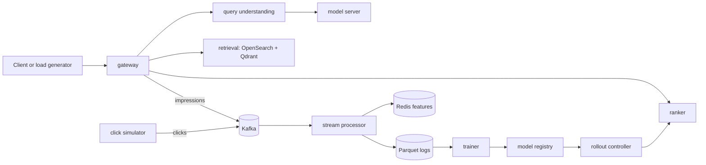

# BharatSearch + Predictive Autoscaler: Implementation Guide

Nov 4, 2026 · @Praneeth

Build the system in the order below: every section ends with an acceptance test that says when that component is done, and Section 14 defines the quality bar for the finished repo. It assumes the architecture and scope from the project doc and adds schemas, configs, algorithms, commands, and test plans.

## 0. Conventions and stack

| Layer | Choice | Local note |
| --- | --- | --- |
| Language | Python 3.12 for services, eval, forecasting | No Rust components; sarvam1 is a published tokenizer |
| Packaging | uv with a lockfile, ruff, pytest, pre-commit | One workspace, shared `libs/` |
| API | FastAPI + Uvicorn, pydantic v2 contracts | Every contract lives in `libs/contracts` |
| Lexical search | OpenSearch, single node, security plugin off | 1 GB heap in the lite profile |
| Dense search | Qdrant | Embeddings: multilingual-e5-small (lite), BGE-M3 (standard, full) |
| LLM serving | Any OpenAI-compatible endpoint | Stub (lite, CI), Ollama or llama.cpp (standard), vLLM (full) |
| Streaming | Kafka (KRaft, single node) via confluent-kafka | Topics created by an init job, auto-create off |
| Features | Redis online, Parquet offline, DuckDB for analysis |  |
| Ranking | LightGBM LambdaRank | File-based model registry; MLflow optional |
| Observability | OpenTelemetry, Prometheus, Grafana | Provisioned from files, no manual clicks |
| Orchestration | Docker Compose (core), kind + KEDA + metrics-server (autoscaler) |  |
| Load | k6 | Open-loop arrival-rate executors |
| CI | GitHub Actions | Stub model, tiny fixture |

**Rules that apply everywhere**

1. Every service exposes `/healthz`, `/readyz`, and `/metrics`.
2. Cross-service payloads are pydantic models in `libs/contracts`; services import them, never redefine them.
3. Configuration comes from environment variables plus one `config/default.yaml`. No hidden constants.
4. Every random process takes a seed, and the seed is written to the run manifest.
5. Every batch job writes to `results/<run_id>/` with a config snapshot, git SHA, and package versions.
6. Pin each image and package version the first time it works. Details marked *verify* (flags, mapping options, image environment variables) must be checked against the docs of the version you pin.

Add a `libs/` directory to the repo layout: `libs/contracts`, `libs/common` (config, logging, tracing), `libs/kafka_utils`, `libs/metrics`.

## 1. Bootstrap (week 1)

### 1.1 Repository and tooling

- `uv init` a workspace; each service is a workspace member with its own `pyproject.toml`.
- `ruff` for lint and format, `pytest` with markers `unit`, `integration`, `e2e`, `slow`.
- `pre-commit` runs ruff and a secrets check.
- `.env.example` holds `PROFILE=lite|standard|full`, model-server URL and model name, and ports. Nothing in the repo reads secrets; there are none.

### 1.2 Makefile contract

| Target | What it does |
| --- | --- |
| `make setup` | Creates the environment, downloads the embedding model, the dataset, and (standard profile) pulls the LLM, then builds the sample slice |
| `make up` / `make down` | Starts or stops the Compose stack for `PROFILE`; `make clean` also removes volumes |
| `make data` | Builds catalog slice, query variants, and the gold-set review file |
| `make index` | Loads OpenSearch and Qdrant |
| `make eval` | Runs every search configuration, writes `results/` and the Markdown report |
| `make smoke` | End-to-end check on a tiny fixture in under 3 minutes |
| `make demo` | Runs the scripted demo steps (Section 12) |
| `make kind-up` / `make kind-down` | Local Kubernetes with metrics-server, KEDA, and Prometheus |
| `make autoscale-bench` | Runs the autoscaler experiment matrix (Section 9) |
| `make test` / `make lint` | Unit and integration tests; lint |

### 1.3 Compose design

One `docker-compose.yml`, profiles select the model server. Health checks gate `depends_on`.

```yaml
x-common: &common
  restart: unless-stopped
  networks: [bharat]

services:
  opensearch:
    <<: *common
    image: opensearchproject/opensearch:<pin>
    environment:
      - discovery.type=single-node
      - DISABLE_SECURITY_PLUGIN=true        # verify for your version
      - OPENSEARCH_JAVA_OPTS=-Xms1g -Xmx1g
    ports: ['9200:9200']
  qdrant:
    <<: *common
    image: qdrant/qdrant:<pin>
    ports: ['6333:6333']
  redis:
    <<: *common
    image: redis:<pin>
  kafka:
    <<: *common
    image: apache/kafka:<pin>               # image default single-node KRaft config
  model-server-lite:
    <<: *common
    profiles: [lite]
    build: ./services/stub-inference
  model-server-standard:
    <<: *common
    profiles: [standard]
    image: ollama/ollama:<pin>
```

The application services (gateway, query-understanding, retrieval, ranker, stream-processor, trainer, rollout-controller) are built from the repo and share one base image to keep builds fast. Prometheus, Grafana, and the OpenTelemetry collector mount config from `deploy/observability/`.

### 1.4 CI

- **lint-unit:** ruff, then unit tests.
- **smoke:** brings up the lite profile on the fixture (about 500 products, 50 queries), runs `make smoke`.
- **eval-regression:** runs the search evals on the fixture and compares to `eval/baselines/main.json`; fails if any gated metric drops by more than its configured tolerance.

**Acceptance test:** on a clean clone, `make setup && make up && make smoke` passes, and `make down` leaves no containers running.

## 2. Data pipeline (weeks 1-2)

### 2.1 Source data and slice

Use the Amazon Shopping Queries dataset (ESCI): English queries, products, and judgments labeled Exact, Substitute, Complement, or Irrelevant. Verify column names against the dataset README; expect `query_id`, `query`, `product_id`, `product_locale`, `esci_label`, `split`, and the product title, description, bullet, brand, and color fields.

1. Filter to the US locale and the reduced (small) version so it fits a laptop.
2. Sample 3,000 train, 500 dev, and 500 test queries, keeping only queries with at least one Exact product.
3. Keep every judged product for those queries (this preserves the hard negatives), then add random products from the same locale until the catalog reaches the profile's target size (about 60k for lite; scale up for standard).
4. Derive a coarse `cluster_id` by k-means (k of 50-100) on product embeddings. ESCI has no category taxonomy and no price, so the ranker uses `cluster_id` and drops price features from the earlier plan.

| Artifact | Key columns |
| --- | --- |
| `catalog.parquet` | `product_id`, `title`, `brand`, `bullets`, `description` (truncated to 1,000 chars), `color`, `cluster_id` |
| `queries.parquet` | `query_id`, `query_text`, `split`, `source_query_id` (null for originals), `variant_type`, `language_tag`, `transforms` (list), `gold` (bool) |
| `qrels.parquet` | `query_id`, `product_id`, `label` (3 Exact, 2 Substitute, 1 Complement, 0 Irrelevant) |

Variants inherit the qrels of their source query.

### 2.2 Query variant generator

The catalog is English, so a Hindi or Hinglish query cannot match it lexically. That is the gap this project measures and closes. Generate variants from the English queries (`data/make_variants.py`):

| Variant type | Share | How it is made |
| --- | --- | --- |
| `clean_en` | 20% | The original query |
| `typo_en` | 20% | Noise functions only |
| `hinglish_roman` | 25% | LLM rewrite into romanized Hindi as an Indian user would type it, then optional noise |
| `codemixed` | 20% | LLM rewrite mixing English nouns with Hindi function words |
| `devanagari` | 10% | LLM translation into Devanagari |
| `other_indic` | 5% | Optional (Bengali, Tamil, Telugu); drop this row if the local model is weak in those languages |

**Noise functions** (each takes a seeded RNG and is applied with a configurable probability):

| Transform | Example |
| --- | --- |
| Vowel dropping | `smartphone cover` to `smrtphn cvr` |
| Letter repetition | `shoes` to `shooes` |
| Phonetic substitution (ph/f, w/v, aa/a, ee/i) | `phone` to `fone` |
| Keyboard-adjacent substitution | `water` to `wster` |
| Space merge or split | `water bottle` to `waterbottle` |
| Chat abbreviations | `for` to `4`, `please` to `plz` |

**LLM rewrite rules.** Temperature 0.7, one query per call, JSON output `{"rewrite": "..."}`, instructions to keep brand names and numbers unchanged, and no added attributes. Record the model name and prompt hash in each row's `transforms`.

**Meaning-drift filter.** Embed the source query and the back-translation of the variant (a second LLM call into English). Reject the variant if cosine similarity falls below a threshold tuned on the dev gold set (start at 0.8). Also reject empty strings, edit distance of 0 from the source for non-clean types, and duplicates.

### 2.3 Gold set

1. Sample 400 variants stratified by `variant_type`.
2. Review each with a small CLI (`python -m data.review`) showing source and variant, with keys for accept, fix (edit the text), and reject.
3. Expect to keep at least 90%; if the rejection rate is higher, fix the generator before scaling up.
4. Split into `gold_dev` (150, used for tuning prompts and thresholds) and `gold_test` (250, frozen until final numbers).

State in the write-up that variants are synthetic and the gold set is single-reviewer.

**Acceptance test:** `make data` with the same seed yields byte-identical Parquet files (compare file hashes), and the generated stats report shows counts per variant type, label distribution, and the rejection rate of each filter.

## 3. Search baseline (weeks 2-3)

### 3.1 OpenSearch index

```json
{
  "settings": {"index": {"number_of_shards": 1, "number_of_replicas": 0,
    "similarity": {"default": {"type": "BM25", "k1": 1.2, "b": 0.75}}}},
  "mappings": {"properties": {
    "product_id": {"type": "keyword"},
    "title": {"type": "text", "fields": {"en": {"type": "text", "analyzer": "english"}}},
    "brand": {"type": "text", "fields": {"raw": {"type": "keyword"}}},
    "bullets": {"type": "text"},
    "description": {"type": "text"},
    "cluster_id": {"type": "integer"},
    "title_tok": {"type": "text", "analyzer": "whitespace"}
  }}
}
```

`title_tok` is reserved for text pre-tokenized by sarvam1 (Section 5.5); leave it empty until the tokenizer passes its gate. Query with a `multi_match` over `title^3`, `title.en^2`, `brand^2`, `bullets`, and `description^0.5`. Keep the query-builder in one function so analyzer experiments swap fields, not code.

### 3.2 Qdrant collection and embeddings

- One collection, cosine distance, vector size set by the model (384 for multilingual-e5-small, 1,024 for BGE-M3; *verify*), payload `product_id` and `cluster_id`.
- Upsert in batches of 256 with deterministic point IDs derived from `product_id`.
- e5 models expect ` query:  ` and ` passage:  ` prefixes; BGE-M3 does not. Put the prefix rule in the model config, not in call sites.
- The embedding service (`/embed`) batches requests, caches query embeddings in an LRU cache, and reports batch size and latency histograms. Measure catalog indexing time once and write it into the README.

### 3.3 Fusion

Take the top 100 from each retriever and fuse with reciprocal rank fusion:

```python
def rrf(rankings: list[list[str]], k: int = 60, top: int = 100) -> list[tuple[str, float]]:
    scores: dict[str, float] = {}
    for ranking in rankings:
        for rank, pid in enumerate(ranking, start=1):
            scores[pid] = scores.get(pid, 0.0) + 1.0 / (k + rank)
    return sorted(scores.items(), key=lambda x: -x[1])[:top]
```

Tune `k` and compare against weighted score fusion on `gold_dev` only.

### 3.4 Search API contract

`POST /v1/search` with `query`, `session_id`, optional `user_id`, `k` (default 20), and `debug` (bool). The response carries `request_id`, `results` (`product_id`, `score`, `rank`), `understanding` (`corrected_query`, `language`, `intent`, `source`: `llm`, `cache`, or `fallback`), `timing_ms` per stage, and `model_versions` (ranker, embedder, LLM). Every response also emits an impression event (Section 6).

**Acceptance test:** BM25-only and hybrid runs exist for all variants and are recorded in the Section 4 report. The BM25 gap between `clean_en` and `hinglish_roman` should be large; if it is not, the variant generator is too easy and must be fixed before moving on.

## 4. Evaluation harness (week 3, protect this)

### 4.1 Formats

- `qrels.jsonl`: `{query_id, product_id, label}` using the 3/2/1/0 scale.
- `run.jsonl`: one line per query, `{query_id, ranked: [product_id, ...], latency_ms}`.
- `results/<run_id>/metrics.json`: metrics overall and per slice, with 95% confidence intervals.

### 4.2 Metrics

```python
GAIN = {3: 1.0, 2: 0.1, 1: 0.01, 0: 0.0}


def dcg(labels):
    return sum(GAIN[l] / math.log2(i + 2) for i, l in enumerate(labels))


def ndcg_at_k(ranked, qrels_q, k=10):
    gains = [qrels_q.get(p, 0) for p in ranked[:k]]  # unjudged counts as 0
    ideal = sorted(qrels_q.values(), reverse=True)[:k]
    d = dcg(ideal)
    return dcg(gains) / d if d > 0 else None  # skip queries with no relevant item
```

- **NDCG@10** as above. Also report **judged@10** (share of top-10 results with a judgment), because unjudged results count as zero and bias comparisons against configurations that retrieve new products.
- **MRR** over the first Exact item.
- **Recall@50** over Exact items.
- **Correction accuracy** on the gold sets: the share of corrected queries whose embedding cosine to the source English query is at least the tuned threshold, plus token-level F1 against the source.

### 4.3 Slices and statistics

Break every metric down by `variant_type`, `language_tag`, query length bucket, and whether the query contains a brand. Compute 95% confidence intervals by bootstrapping queries (1,000 resamples). Compare two configurations with a paired bootstrap on per-query deltas, and report the delta with its interval, never just two means.

### 4.4 Report and regression gate

- `make eval` writes `metrics.json` and `docs/benchmarks/<date>.md`, a table of configurations by slice.
- `eval/baselines/main.json` stores the last accepted metrics. CI fails when NDCG@10 on the fixture drops by more than a configured tolerance (start at 0.5 absolute points) or p99 latency exceeds its budget.
- Update the baseline only in a commit that explains why.

**Acceptance test:** the harness reproduces a hand-computed NDCG on a 3-query toy example (committed as a unit test), and two runs of `make eval` with the same seeds produce identical `metrics.json` apart from timing fields.

## 5. Query understanding (weeks 4-5)

This service turns a noisy query into something the English catalog can match, and it must never make search slower or less reliable than the baseline.

### 5.1 Pipeline

1. **Normalize:** Unicode NFC, strip control characters, collapse whitespace, casefold Latin text, leave Devanagari untouched.
2. **Detect script and language:** Unicode-block share gives the script. A small classifier on character n-grams separates English from romanized Hindi and code-mixed text (labels `en`, `hi-Latn`, `hi`, `mixed`). Train it on the train split only and report accuracy on `gold_dev`.
3. **Cache lookup:** key is the SHA-1 of the normalized query, prompt version, and model name; store in Redis with a 7-day TTL. A hit skips the LLM.
4. **Candidate retrieval (the RAG step):** build a catalog vocabulary of brands and frequent title n-grams (1-3 words, document frequency of at least 5). For a query, take the top 10 by character 3-gram TF-IDF cosine and the top 10 by embedding similarity. The embedding side is what links Hindi or Hinglish words to English terms.
5. **LLM call:** prompt with the query and candidates, structured JSON output, hard timeout, at most one retry and only if the budget remains.
6. **Validate:** parse against the pydantic schema, then apply guards (below). Failure means fallback.
7. **Fallback:** the normalized raw query, `source=fallback`, a counter incremented.

**Guards.** Reject a rewrite if its length exceeds three times the original token count plus two, if it contains a brand that is in neither the query nor the candidates, or if its embedding cosine to the original query is below 0.6 (tune on `gold_dev`).

**Cascade.** Calling the LLM for every query is wasteful. Call it only when the query is not detected as clean English, or when the BM25 top score for the normalized query is below a threshold. Measure how much traffic the cascade sends to the LLM.

### 5.2 Prompt and output contract

Version the prompt in `prompts/qu_v1.txt` and include its hash in every cache key.

```text
You rewrite shopping search queries written by Indian users (English, Hinglish,
Hindi, with typos) into clean English product search queries.
Rules:
- Prefer terms from the candidate list when they match the user's intent.
- Never invent brands, sizes, or attributes. Keep numbers and brand names.
- Output JSON only, matching the schema.
Candidates: {candidates}
Query: {query}
```

Schema (pydantic): `corrected_query` (str), `language` (enum `en`, `hi-Latn`, `hi`, `mixed`, `other`), `intent` (enum `product`, `brand`, `attribute`, `unknown`), `brand` (str or null). Use three to five few-shot examples drawn from `gold_dev` only, fixed in the repo. Server-side constrained decoding exists in llama.cpp (grammars), Ollama (a `format` parameter), and vLLM (guided decoding); *verify* the option for your version, and always validate the output anyway.

### 5.3 Model client and protection

- Async HTTP client to the OpenAI-compatible `/v1/chat/completions` endpoint, temperature 0, `max_tokens` 64, a fixed seed where the server supports one.
- A concurrency semaphore sized to the model server.
- A circuit breaker: open after N consecutive timeouts, half-open after 30 seconds, and fallback while open.
- Metrics: `qu_llm_latency_seconds` (histogram), `qu_source_total{source}`, `qu_cache_hit_ratio`, `qu_guard_reject_total{reason}`.

### 5.4 Evaluation protocol

Run these configurations on `gold_dev` while tuning, and on `gold_test` once at the end:

| Config | Purpose |
| --- | --- |
| Normalization only | Floor |
| Normalization + fuzzy candidates, no LLM | Value of the cheap path |
| LLM without candidates | Value of retrieval grounding |
| LLM with candidates (RAG) | Target |
| Smaller model vs 7-8B quantized | Cost and quality trade-off |
| Cascade on | Traffic sent to the LLM and its quality cost |

**Decision rule:** keep the LLM step only if the NDCG@10 gain on the `hinglish_roman` and `codemixed` slices has a confidence interval above zero and p95 added latency on a cache miss stays within the budget you set after measuring (write the budget in `config/default.yaml`). Otherwise ship the cheap path and say so in the write-up.

### 5.5 Where sarvam1 fits, and the experiment that decides it

The catalog is English, so a custom Indic tokenizer has no useful role as a BM25 analyzer unless you add Indic-language product fields (an optional stretch: LLM-translated titles for a catalog subset, indexed in `title_tok`). Correct the earlier plan accordingly. The place it can genuinely help is query-side modeling, so test it there:

**Experiment T1: a small query-to-catalog-term model.** Train a 2-4 layer transformer bi-encoder from scratch with in-batch contrastive loss (InfoNCE) on pairs of (variant query, source English query) from the train split. Evaluate recall@1 and recall@5 of retrieving the source query among all clean English queries, per variant type. Use the same architecture, parameter budget, data, and seeds for every tokenizer, and change only the tokenizer:

| Tokenizer | Role |
| --- | --- |
| sarvam1 | System under test (default choice) |
| XLM-R tokenizer | Standard multilingual encoder tokenizer |
| Byte-level | Floor that needs no vocabulary |

**Gate:** sarvam1 is wired into the product (as the fast-path encoder or the language classifier's input) only if it matches or beats the best baseline on the `hinglish_roman` and `devanagari` slices by paired bootstrap and the fertility benchmark from the project doc supports it. If not, publish the comparison as a research note and use the best-performing tokenizer. Either result is a legitimate, honest finding.

**Acceptance test:** an ablation table exists for Section 5.4 with confidence intervals; the T1 comparison table exists; a unit test covers every guard; and killing the model server mid-run leaves search working in fallback mode with no errors visible to the client.

## 6. Kafka event backbone (weeks 6-7)

### 6.1 Topics

| Topic | Key | Partitions | Retention | Producer | Consumers |
| --- | --- | --- | --- | --- | --- |
| `search.queries` | `session_id` | 6 | 7 days | gateway | query log writer |
| `search.impressions` | `session_id` | 6 | 7 days | gateway | feature updater, dataset writer |
| `search.clicks` | `session_id` | 6 | 7 days | simulator | feature updater, dataset writer |
| `search.shadow_diffs` | `request_id` | 3 | 3 days | ranker | rollout controller |
| `search.retry.5s`, `search.retry.30s` | original key | 6 | 1 day | consumers | retry workers |
| `search.dlq` | original key | 3 | 14 days | consumers | replay tool |
| `model.events` | model name | 1 | 30 days | trainer, rollout controller | ranker, gateway |

Keying by `session_id` keeps a session's impression before its click, which the dataset join relies on. Six partitions are enough to exercise parallelism and rebalancing on one machine.

### 6.2 Event envelope

Every event carries `event_id` (UUIDv7), `event_type`, `schema_version`, `ts` (UTC milliseconds), `session_id`, `request_id`, and `payload`. Keep simulator-only fields (ground-truth labels, variant type) in a separate `debug` object that the feature code is forbidden from reading, so the model cannot leak labels.

- **Impression payload:** query raw and corrected, `understanding.source`, the shown results (`product_id`, `rank`), the feature vector actually served for each, `ranker_version`, `exploration` flag, and the logging propensity when exploration was applied.
- **Click payload:** `request_id`, `product_id`, `rank`.
- **Idempotency:** consumers record `event_id` in Redis with SET NX and a TTL; a repeat is acknowledged and skipped.

**Producer settings:** `acks=all`, idempotence on, `linger.ms` around 5, lz4 compression. The gateway publishes through a bounded in-memory queue and never blocks a search on Kafka. If the queue is full, drop the event and increment `events_dropped_total`.

### 6.3 Resilient consumer framework (`libs/kafka_utils`)

This is the Uber-inspired core. Goals: one slow or poisonous message must not stall a partition, commits must never skip an unfinished message, and rebalances must not lose or duplicate work beyond what idempotency absorbs.

**Design**

- One poll loop. Auto-commit off.
- Each assigned partition has an `OffsetTracker`. Messages are dispatched to a worker pool, partitioned by key hash so messages with the same key stay ordered while different keys run in parallel.
- The committable offset for a partition is the lowest in-flight offset (everything below it is done).
- Backpressure: pause a partition when its in-flight count passes a high-water mark, resume at half.

```python
class OffsetTracker:
    def __init__(self, start: int):
        self.next_expected = start  # lowest offset not yet finished
        self.done: set[int] = set()

    def mark_done(self, offset: int) -> int | None:
        self.done.add(offset)
        advanced = False
        while self.next_expected in self.done:
            self.done.remove(self.next_expected)
            self.next_expected += 1
            advanced = True
        return self.next_expected if advanced else None  # commit this offset
```

**Rebalance handling.** On revoke: stop dispatching, wait for in-flight work up to a timeout, commit each tracker's offset, drop the state. On assign: create trackers starting at the committed offset. Use cooperative rebalancing where your client version supports it (*verify*).

**Failure handling.** Classify exceptions as retryable (network, timeouts) or non-retryable (deserialization, validation). Retryable: publish to `search.retry.5s`, then `search.retry.30s`, with headers for attempt count and original topic, partition, and offset; a retry worker pauses until the not-before time. After the last tier, or immediately for non-retryable errors, publish to `search.dlq` with the error class and message. The original offset is then marked done so the partition keeps moving.

**Metrics** (exported on every consumer): `consumer_lag{group,topic,partition}`, `inflight_messages`, `message_processing_seconds`, `retries_total{tier}`, `dlq_total{reason}`, `rebalances_total`, `rebalance_seconds`, `seconds_since_last_poll`.

**Lag monitor** (a separate small service): computes lag from committed offsets and end offsets, and classifies a lagging group as **slow** (lag growing while the consume rate is positive) or **stuck** (lag growing with a consume rate near zero). Prometheus alert rules cover both, plus a rebalance storm (more than three rebalances in five minutes).

**Tests that prove it works**

| Scenario | Pass condition |
| --- | --- |
| 0.1% poison messages | Following messages on the same partition are processed with unchanged p99 |
| 1% slow messages (10x normal) | Other keys on the partition are not delayed beyond one service time |
| Kill the consumer mid-flight | No message lost; duplicates are skipped by idempotency |
| Rebalance under load | The produced and processed event ID sets are identical |
| DLQ replay | Replayed messages are processed and removed from the DLQ backlog |

**Benchmark for the resume.** Compare a plain sequential consumer with this framework at the same load, with 1% slow and 0.1% poison messages injected. Report p99 end-to-end event latency, throughput, and recovery time after a restart.

**Acceptance test:** every scenario in the table passes in `make test-integration`, and the benchmark script writes its table to `docs/benchmarks/`.

## 7. Click simulator, features, and ranker (weeks 6-7)

### 7.1 Click simulator

The learning loop needs interaction data, so simulate it from the qrels. State this clearly in the write-up: the loop proves the mechanics and the safety gates, not real-world gains.

- **Click model:** a position-based model, where P(click) = examination(rank) × attractiveness(label). Use examination(r) = r^(-eta) with eta near 1 (configurable). Attractiveness by label: Exact 0.7, Substitute 0.25, Complement 0.08, Irrelevant 0.02, unjudged 0.01 (all configurable).
- **Sessions:** sample queries with a Zipf popularity distribution from the train variants, show the top 10 (or 20), draw clicks from the model, and optionally reformulate after a no-click result.
- **Exploration:** for a configurable share of traffic (start at 5%), shuffle positions 3-10 and log the propensity. This breaks the feedback loop where the model only learns about products it already ranks high.
- **Determinism:** seed everything; log the seed and parameters in the run manifest.

### 7.2 Features

| Feature | Computed | Source |
| --- | --- | --- |
| `bm25_score`, `dense_score`, `rrf_score`, `bm25_rank`, `dense_rank` | Query time | Retrieval |
| `title_len`, `brand_match` (query-token overlap with brand) | Query time | Catalog + query |
| `query_len_tokens`, `query_lang`, `qu_source` | Query time | Query understanding |
| `product_ctr` | Streaming | Smoothed decayed counters in Redis |
| `product_impr_log` | Streaming | Same counters |
| `qc_pc_ctr` (query cluster by product cluster) | Streaming | k-means on query embeddings (k near 100) crossed with `cluster_id` |
| `session_clicks` | Streaming | Session counter (the cold-start signal) |

Do not feed rank or position to the ranker: it is unknown at inference time.

**Redis design.** Use exponentially decayed counters instead of time buckets: store `value` and `last_ts` in a hash, and on update compute `value = value * 0.5^((now - last_ts) / half_life) + increment`, atomically in a Lua script. Smooth CTR as `(clicks + a) / (impressions + a + b)` with the prior mean taken from the product's cluster. Keys: `pf:{product_id}`, `qpf:{query_cluster}:{cluster_id}`, `sess:{session_id}`.

**Log what you served.** Every impression event carries the exact feature vector used at serving time, and the dataset writer persists it to Parquet partitioned by date. Training reads these logged features and never recomputes them, which removes training-serving skew.

### 7.3 Training

- **Dataset:** join impressions to clicks on `request_id`; label 1 for a click, else 0. Group by `request_id`. Split by time, never randomly.
- **Position bias:** weight each row by 1 / examination(rank), clipped at 10. Start with the assumed `eta`, then estimate the examination curve from the exploration traffic (compare click rates for the same product at swapped ranks) and use the estimate.
- **Model:** LightGBM LambdaRank.

| Parameter | Start value |
| --- | --- |
| `objective` | `lambdarank` |
| `metric`, `eval_at` | `ndcg`, 10 |
| `learning_rate` | 0.05 |
| `num_leaves` | 31 |
| `min_data_in_leaf` | 50 |
| `feature_fraction`, `bagging_fraction` | 0.8, 0.8 |
| `lambdarank_truncation_level` | 20 |
| Early stopping | On the time-split validation set |
| `seed` | Fixed and logged |

- **Offline evaluation of a candidate:** oracle NDCG@10 on the held-out qrels (available only because this is a simulation) and IPS-weighted click NDCG on the logged validation window. Report both and how well they agree.
- **Registry:** `models/ranker/<version>/model.txt` plus `manifest.json` with version, created time, git SHA, data window, parameters, metrics, parent version, and a **feature-schema hash**. The ranker service refuses to load a model whose schema hash differs from its own.
- **Retrain trigger:** after N new impressions or T minutes, with a minimum data volume. The job is idempotent and pins its data window. On success it emits `candidate_ready` on `model.events`.

**Acceptance test:** a ranker trained only on simulated clicks beats the untrained RRF ordering on oracle NDCG@10 with a confidence interval above zero. If it does not, check the simulator parameters, propensity weights, and exploration rate before blaming the model.

## 8. Rollout controller (week 7)

### 8.1 State machine

```text
CANDIDATE -> SHADOW -> CANARY_1 -> CANARY_10 -> CANARY_50 -> PROMOTED
     \          \          \           \            \
      +----------+----------+-----------+------------+--> ROLLED_BACK (any gate hard-fails)
```

### 8.2 Traffic assignment

Hash `session_id` with a per-rollout salt into a bucket from 0 to 9999. A session uses the candidate when its bucket is below `percent * 100`. This keeps a session's experience stable and makes the split reproducible.

### 8.3 Shadow evaluation

In SHADOW the ranker computes the candidate ordering alongside the incumbent on the same features and emits a `search.shadow_diffs` event: both top-10 lists, overlap@10, Kendall tau, and both inference latencies. Only the incumbent's ordering is returned to the client.

### 8.4 Gates

| Gate | Rule | On failure |
| --- | --- | --- |
| Quality | Paired bootstrap lower bound of (candidate minus incumbent) oracle NDCG@10 is at least minus the tolerance | Rollback |
| Click quality (canary stages) | IPS-weighted click NDCG lower bound clears the same rule | Rollback |
| Latency | Candidate p99 is at most 1.1 times the incumbent's and within the absolute budget | Rollback |
| Errors | Error rate no more than 0.1 points above the incumbent | Rollback |
| Sanity | Overlap@10 above a floor, no NaN or infinite scores, score-distribution PSI under 0.25 | Rollback |
| Sample size | Minimum requests per stage reached | Wait; abort after `max_wait` |

Oracle quality is measurable here only because the simulator knows the labels. In the write-up, say that a production system would rely on the click-based gate and interleaving instead.

```yaml
rollout:
  stages: [shadow, 1, 10, 50, 100]
  min_requests: {shadow: 2000, 1: 1000, 10: 2000, 50: 4000}
  max_wait_minutes: 20
  gates:
    ndcg_tolerance: 0.002
    latency_p99_ratio: 1.1
    latency_p99_budget_ms: 150
    error_rate_delta: 0.001
    overlap_floor: 0.3
    psi_max: 0.25
  bootstrap: {resamples: 1000, ci: 0.95}
```

### 8.5 Rollback

Set the routing key `rollout:current` in Redis to the incumbent atomically, emit a `rollback` event on `model.events` with the failing gate and numbers, raise an alert, and keep the candidate in the registry marked `rejected`. The operation is idempotent.

### 8.6 Tests

Build four deliberately bad candidates plus one good one:

| Candidate | Expected outcome |
| --- | --- |
| Trained on shuffled labels | Rejected by the quality gate |
| Adds artificial latency | Rejected by the latency gate |
| Feature-schema mismatch | Refused at load time |
| Emits NaN scores | Rejected by the sanity gate |
| Properly trained | Promoted through every stage |

**Acceptance test:** all five behave as expected end to end, each with its reason in the controller log and a screenshot of the Grafana rollout dashboard saved under `docs/`.

## 9. Predictive autoscaler (weeks 8-9)

### 9.1 Scope and setup

The autoscaler experiments run in **synthetic mode** on a local kind cluster, because a laptop cannot host the real stack, a dozen-plus scaled pods, and a load generator at once, and because a stub makes runs reproducible. Services in the cluster:

- `gateway-lite` (FastAPI): accepts `/search`, calls the retrieval stub with a fixed latency distribution, and on a configurable cache-miss fraction calls `stub-inference`. It has a request timeout and no retries, so overload shows up as errors instead of hidden retry storms.
- `stub-inference`: the scaled workload, standing in for the LLM server.
- `stub-retrieval`: constant-latency responder.

Validate the real stack separately with one Compose load test (Section 11) so the stub's parameters can be checked against reality. Setup for kind: install metrics-server (on kind it usually needs `--kubelet-insecure-tls`; *verify*), kube-prometheus-stack (Prometheus, Grafana, kube-state-metrics), and KEDA.

### 9.2 Stub inference specification

| Setting | Default | Meaning |
| --- | --- | --- |
| `SERVICE_MEAN_MS` | 180 | Mean service time |
| `SERVICE_SIGMA` | 0.4 | Log-normal shape of service time |
| `CONCURRENCY` | 8 | Requests processed in parallel per pod |
| `QUEUE_LIMIT` | 64 | Requests waiting before the pod rejects with 503 |
| `COLD_START_S` | 40 | Delay before `/readyz` returns 200 (simulated model load) |
| `CPU_FRACTION` | 0.3 | Share of each service time spent burning CPU |

- **Capacity per pod** is about `CONCURRENCY / (SERVICE_MEAN_MS / 1000)`, roughly 44 requests per second with the defaults. The controller reads this number from config.
- **CPU must track load.** A stub that only sleeps uses almost no CPU, which would make the CPU-based HPA baseline meaningless. `CPU_FRACTION` makes each request burn CPU in a worker thread for that share of its service time, so utilization rises with load as it would for a real model server.
- **Interface.** A minimal OpenAI-compatible `/v1/chat/completions` that returns a canned corrected query from a lookup table, so the query-understanding client works unchanged.
- **Metrics:** `inference_requests_total`, `inference_in_flight`, `inference_queue_depth`, `inference_latency_seconds` (histogram), `inference_rejected_total`.
- **Resources:** 100m CPU and 128 Mi memory requests and limits; fix them so CPU utilization is comparable across runs.
- **Calibration.** Once, on the standard profile, measure the real model's load time and latency against concurrency, then set the stub's parameters to match and record the table in `docs/stub-calibration.md`. State the stub's assumptions next to every autoscaler result.

### 9.3 Load profiles and the load generator

Curves are CSV files (`t_seconds`, `rps`) generated by `loadgen/make_curves.py` with a seed, and committed with their hash. Runs are real time and last 30 minutes (a quick mode uses 10-minute curves and a 20-second cold start for development and CI).

| Profile | Shape (requests per second) |
| --- | --- |
| `steady` | 150 with small noise |
| `diurnal` | Sinusoid between 60 and 300 over a compressed 15-minute day |
| `matchday` | Minutes 0-8 ramp 60 to 200; minute 8 step to 260; random spikes of 1.6x-2.2x lasting 20-60 s at about one every two minutes; minutes 14-17 dip to 80 (innings break); minutes 17-26 ramp to a 380 peak; minute 28 drop to 40 |
| `flashcrowd` | 120, then a step to 360 at minute 10, held 5 minutes, then back to 120 |

Use different seeds for tuning curves, forecaster training curves, and evaluation curves.

```javascript
import http from 'k6/http';
const curve = JSON.parse(open('./curves/matchday_seed1.json'));   // [{t, rps}] at 10 s steps
const queries = JSON.parse(open('./queries.json'));
export const options = {
  scenarios: {
    load: {
      executor: 'ramping-arrival-rate',   // open loop: offered load does not slow when the system does
      startRate: curve[0].rps,
      timeUnit: '1s',
      preAllocatedVUs: 200,
      maxVUs: 1000,
      stages: curve.map(p => ({ target: p.rps, duration: '10s' })),
    },
  },
};
export default function () {
  const q = queries[Math.floor(Math.random() * queries.length)];
  http.get(__ENV.TARGET + '/search?q=' + encodeURIComponent(q));
}
```

Open-loop arrival is essential: a closed-loop generator slows down when the system slows, which hides exactly the overload you want to measure. The load generator shares the laptop with the cluster, so a run is **invalid** if k6 reports more than 0.5% dropped iterations or node CPU stays above 80%. Rerun invalid runs.

### 9.4 Metrics, SLO, and cost definitions

Prometheus recording rules (names are suggestions):

```text
rps:rate30s       = sum(rate(gateway_requests_total[30s]))
p99:1m            = histogram_quantile(0.99, sum by (le) (rate(gateway_request_duration_seconds_bucket[1m])))
err_ratio:1m      = sum(rate(gateway_requests_total{code=~"5..|timeout"}[1m])) / sum(rate(gateway_requests_total[1m]))
ready_pods        = kube_deployment_status_replicas_ready{deployment="stub-inference"}
spec_pods         = kube_deployment_spec_replicas{deployment="stub-inference"}
```

Export raw series after each run (5-second step) and compute results offline from the export, so the analysis never depends on rule evaluation timing.

| Metric | Definition |
| --- | --- |
| SLO target | p99 at or below 400 ms and error ratio at or below 1% (set in config, derived from the stub's service time) |
| SLO violation minutes | Count of one-minute windows where either target is missed |
| Pod-seconds (cost proxy) | Integral of pods that exist (starting or ready), because a cold-starting pod still costs |
| Over-provisioning ratio | Ready capacity divided by offered load, over windows without violations |
| Time-to-capacity | From the moment offered load exceeds ready capacity times target utilization until ready capacity covers it again |
| Thrash | Number of replica-count changes |

### 9.5 Strategies

1. **S1, HPA on CPU** (`autoscaling/v2`): target average utilization, plus `behavior` for the scale-down stabilization window.
2. **S2, KEDA on request rate:** reactive, with a better metric than CPU.
3. **S3, rule-based ladders:** a replica floor taken from a schedule of known events, plus a ladder over observed request rate.
4. **S4, predictive:** forecaster plus ladder, with the reactive requirement as a floor and an automatic fallback.

```yaml
apiVersion: keda.sh/v1alpha1
kind: ScaledObject
metadata: {name: stub-inference}
spec:
  scaleTargetRef: {name: stub-inference}
  minReplicaCount: 2
  maxReplicaCount: 20
  pollingInterval: 10
  cooldownPeriod: 60
  triggers:
    - type: prometheus
      metadata:
        serverAddress: http://<prometheus-service>.monitoring:9090
        query: sum(rate(gateway_requests_total[30s]))
        threshold: '30'        # requests/s per replica; verify the metric-type semantics for your KEDA version
```

**Fairness rules**

- Tune the baselines too. Run a small grid on the tuning curves (HPA target utilization 50, 60, 70 percent; scale-down stabilization 60 and 300 seconds; KEDA threshold 25-40), pick the best per baseline on the tuning curves, and evaluate on separate curves. A baseline left at defaults is a straw man.
- Same minimum and maximum replicas, same initial state, same resource requests for every strategy.
- Only one controller per Deployment. S3 and S4 scale through the Deployment's scale subresource, so the harness deletes any HPA or ScaledObject before them and resets to the minimum replica count between runs.

### 9.6 Forecaster

The forecaster predicts request rate far enough ahead to cover the cold start. Horizon `H` = cold start + control interval + safety margin (about 40 + 15 + 20 = 75 seconds with the defaults). It outputs an **upper quantile** (0.9) of the rate over the window from now to `now + H`, because under-forecasting a ramp is far more costly than over-forecasting.

| Model | Notes |
| --- | --- |
| Persistence (last value) | The floor; effectively reactive |
| Holt linear (level + trend) | Cheap and strong on ramps |
| Schedule-aware | Uses known event times (match start, innings break) as features |
| LightGBM quantile regression | Objective `quantile`, alpha 0.9, on lagged rates (15, 30, 60, 120, 300 s), rolling mean and standard deviation, slope, time since start, schedule flags |

**Backtest before use.** Evaluate by rolling origin on held-out curves, at horizon `H`: pinball loss at 0.9, coverage of the 0.9 quantile (should be near 0.9), and the under-forecast rate during rising phases. **Gate:** a learned model enters the controller only if it beats persistence on pinball loss on the `matchday` curves. Report that result either way.

### 9.7 Controller algorithm

```python
while True:  # every INTERVAL = 15 s
    obs = read_metrics()  # rps, p99, queue depth, current replicas
    forecaster.update(obs.rps)
    f = forecaster.predict_upper(H)  # req/s, upper quantile over the horizon
    cap = cap_per_pod * target_util
    need_react = ceil(obs.rps / cap) + queue_term(obs.queue_depth)
    need_pred = ceil(f / cap)
    target = max(need_react, need_pred if forecaster.confident() else 0)
    target = next_rung(target, LADDER)  # smallest rung >= target
    target = clamp(target, MIN, MAX)
    if target > current:
        scale_to(min(target, current + MAX_STEP))  # scale up immediately
    elif target < current and below_for(K_INTERVALS) and cooldown_elapsed():
        scale_to(prev_rung(current))  # step down one rung at a time
    log_decision(obs, f, need_react, need_pred, target, mode)  # JSONL for later analysis
    sleep(INTERVAL)
```

- **Ladder:** for example `[2, 3, 4, 6, 8, 10, 12, 14, 16, 20]`.
- **Predictive never undercuts reactive:** the forecast can only add capacity ahead of time.
- **Confidence and fallback:** track pinball loss and quantile coverage over the last M predictions; if coverage falls below 0.7 or error rises past a threshold, set `confident = False` (reactive only) and log the mode change. Recover after M good predictions.
- **Safety:** minimum and maximum replicas, a maximum step per interval, a scale-down cooldown of about 120 seconds, and a kill switch (a ConfigMap key `autoscaler.enabled`) that makes the controller stop acting.

### 9.8 Experiment protocol

| Item | Setting |
| --- | --- |
| Strategies | S1-S4, tuned as in 9.5 |
| Profiles | `steady`, `diurnal`, `matchday`, `flashcrowd` |
| Repeats | 3 seeds each for `matchday` and `flashcrowd`, 1 each for `steady` and `diurnal` |
| Run count | 4 strategies x 8 = 32 runs of about 30 minutes, roughly 16 hours of runtime, plus tuning runs |
| Order | Randomized, with a reset and a 2-minute settle between runs |
| Per-run record | Git SHA, seeds, curve hash, parameters, Kubernetes and image versions, machine specs |

**Reporting.** `eval/autoscale_report.py` reads the exported series and writes a table of every metric by strategy and profile (mean with min and max over repeats), a time-series figure per run (request rate, ready pods, p99 against the SLO line), and the share of time S4 spent in fallback mode. Add a lead-time analysis: how many seconds before the load rose did S4 add capacity, compared with S2?

**Expect mixed results and report them honestly.** Prediction should help on ramps (pre-match, second-innings surge) and should not help on unannounced spikes and the flash crowd, where the reactive floor and fast scale-up matter most. A finding such as "predictive scaling cut SLO-violation minutes by X% on scheduled ramps and made no difference on flash crowds" is stronger than a blanket claim.

**Acceptance test:** `make autoscale-bench QUICK=1` finishes in about 15 minutes and writes the report; the full matrix produces the table; a repeated run of one cell lands within the spread of its earlier repeats.

## 10. Observability

**Tracing (OpenTelemetry).** One trace per search: `gateway.search`, then `qu.normalize`, `qu.cache`, `qu.candidates`, `qu.llm`, `retrieval.bm25`, `retrieval.dense`, `fuse`, `ranker.features`, `ranker.score`. Propagate the trace context through HTTP headers and through Kafka message headers (`traceparent`), so a click can be linked back to the search that produced it.

**Metric conventions.** Prefix by service, put units in names (`_seconds`, `_total`), and never use query text, user IDs, or product IDs as labels.

| Dashboard | Panels |
| --- | --- |
| Search overview | Request rate; p50, p95, p99 by stage; error ratio; query-understanding source split (llm, cache, fallback); cache hit ratio; circuit-breaker state |
| Learning loop | Event rates per topic; consumer lag per group; DLQ and retry rates; feature freshness (age of last update); model versions in service; rollout state |
| Consumer health | In-flight messages, processing time, rebalances, seconds since last poll |
| Autoscaler | Request rate against forecast; desired against ready replicas; p99 against the SLO line; predictive or fallback mode; decision-log annotations |

Provision every dashboard and alert from JSON and YAML under `deploy/observability/`; no manual clicking, so a fresh clone gets identical dashboards.

## 11. Testing strategy

| Level | What it covers | Runs in CI |
| --- | --- | --- |
| Unit | Metrics, RRF, `OffsetTracker`, gate math, noise functions, guards, schema validation | Yes |
| Property-based (Hypothesis) | `OffsetTracker`: any completion order commits only a contiguous prefix; noise functions never return empty text | Yes |
| Contract | Pydantic models against golden JSON fixtures; schema-hash check for the ranker | Yes |
| Integration (Compose) | Kafka consumer scenarios from Section 6.3, retrieval against the fixture index, query-understanding fallback | Yes, on the fixture |
| End to end | Query, results, impression, feature visible in Redis, click, feature updated | Yes (`make smoke`) |
| Eval regression | Fixture metrics against `eval/baselines/main.json` | Yes |
| Determinism | Same seed gives the same data, the same metrics, and the same curves | Yes |
| Chaos (local script) | Kill the model server (search falls back); stop the Kafka broker (search unaffected, events dropped and counted); stop Redis (ranker uses default feature values and flags the response) | No, run before demos |
| Real-stack load test | Modest k6 load against Compose; per-stage latencies recorded; used to check stub calibration | No |

A chaos check passes only if clients see no errors from search itself and the corresponding degradation metric increments.

## 12. README, demo, and repository polish

### 12.1 README outline

1. What it is, in three sentences, plus the architecture diagram (a Mermaid block renders on GitHub).
2. Headline results table (search quality by slice, consumer benchmark, autoscaler comparison), each linking to its report.
3. Quickstart: prerequisites, `make setup`, `make up`, `make smoke`, first search with `curl`.
4. Hardware profiles and measured minimum specs.
5. Reproducing results: `make eval`, `make autoscale-bench`, expected runtimes.
6. Repository tour.
7. Limitations (Section 14).
8. Data and model licenses, dataset citation, acknowledgments.
9. Troubleshooting (Appendix B).



**Licenses.** Check the licenses of the dataset and of every model before using them, cite the dataset in the README, and never commit dataset files or model weights; scripts download them.

### 12.2 Demo script (about 10 minutes)

| Step | Command or view | What the audience sees | Minutes |
| --- | --- | --- | --- |
| 0 | Stack already up (`make up PROFILE=standard`), Grafana open | Healthy dashboards | 0 |
| 1 | `python -m demo.compare 'fone cover sasta'` and two or three more queries | Raw BM25 against BharatSearch, side by side, on Hinglish and typo queries | 2 |
| 2 | Start the click simulator | Event rates, consumer lag, and feature freshness moving in Grafana | 2 |
| 3 | `make demo-bad-model` | A deliberately bad ranker rejected by the rollout gate, with the reason; then a good one promoted | 2 |
| 4 | Kill the model server | Search keeps working in fallback mode; the source split changes on the dashboard | 1 |
| 5 | Show the stored autoscaler result plots (the live run takes too long) | Reactive against predictive on the match-day curve: replicas, p99, SLO line | 2 |
| 6 | Recap | The headline tables | 1 |

**Demo fallback.** A screen recording of the full script, plus cached results committed in `docs/demo/`, in case the live run fails.

### 12.3 Fresh-machine test

On a clean VM or a freshly reset Docker Desktop, follow only the README, in order. Record the time to the first successful search and every place you had to improvise, then fix the README or the scripts for each one. Repeat until a run needs no improvisation. Do this before tagging a release.

## 13. Ten-week schedule

Each week ends with its acceptance tests passing. If you fall behind, cut in the order given in the project doc (cold start, then automated retraining, then the learned forecaster), never the evaluation harness or the rollout gate.

**Week 1: foundations**

- [ ] Workspace, tooling, pre-commit, CI skeleton
- [ ] Compose stack (OpenSearch, Qdrant, Redis, Kafka, stub model server) healthy on the lite profile
- [ ] Dataset download script and the sample slice
- [ ] Tokenizer benchmark harness run against Sarvam-1 and one or two others on FLORES and IN22
- [ ] `make setup && make up && make smoke` passes on a clean clone

**Week 2: data and baseline index**

- [ ] Query variant generator with noise functions, drift filter, and stats report
- [ ] Gold set reviewed and split into `gold_dev` and `gold_test`
- [ ] OpenSearch and Qdrant indexing; BM25 baseline run
- [ ] Evaluation harness with the toy-example unit test

**Week 3: hybrid retrieval and API**

- [ ] Embedding service, dense retrieval, RRF fusion
- [ ] `/v1/search` with the full response contract and tracing
- [ ] First benchmark report by slice (BM25 against hybrid); the Hinglish gap is visible

**Week 4: query understanding**

- [ ] Normalization, language detection, cache, candidate retrieval
- [ ] Model client, guards, circuit breaker, fallback
- [ ] End-to-end behavior verified with the model server killed

**Week 5: query-understanding decisions and the tokenizer experiment**

- [ ] Section 5.4 ablations on `gold_dev`; keep-or-drop decision; cascade tuned
- [ ] Experiment T1 run for all four tokenizers; gate decision recorded
- [ ] `gold_test` evaluated once and the numbers saved

**Week 6: events**

- [ ] Topics, envelope contracts, producer with bounded queue
- [ ] Consumer framework with retries, DLQ, rebalance handling, metrics
- [ ] Lag monitor and alerts; all Section 6.3 scenarios passing; benchmark table
- [ ] Click simulator

**Week 7: learning loop**

- [ ] Redis feature counters, dataset writer, feature logging at serving time
- [ ] LightGBM training, registry with schema hash, ranker service with hot reload
- [ ] Rollout controller, gates, and the five test candidates

**Week 8: autoscaler foundations**

- [ ] kind cluster with metrics-server, Prometheus stack, KEDA
- [ ] `stub-inference`, `gateway-lite`, calibration table
- [ ] Curve generator, k6 script, recording rules, export and analysis script
- [ ] S1 and S2 tuned on the tuning curves

**Week 9: predictive control and experiments**

- [ ] Forecasters and the backtest report; model-selection gate
- [ ] Controller with ladders, confidence fallback, safety rules; S3 and S4
- [ ] Full experiment matrix and report

**Week 10: packaging**

- [ ] Dashboards and alerts provisioned from files
- [ ] README, architecture diagram, limitations, ADRs
- [ ] Demo rehearsed and recorded; fresh-machine test passed
- [ ] Resume bullets filled with measured numbers; release tagged `v1.0`

## 14. Quality bar for the finished repo

- [ ] **Reproducible:** a clean clone reaches a first search by following the README alone; seeds, lockfiles, and image tags are pinned; result tables regenerate from scripts.
- [ ] **Evidence:** every headline number has a confidence interval or a spread over repeats; ablations show each component's contribution; `gold_test` was evaluated once; negative results are reported.
- [ ] **Engineering:** CI is green; unit, integration, and smoke tests pass; no secrets or large files in git; dashboards and alerts come from files.
- [ ] **Resilience:** the chaos checks in Section 11 pass; search stays up with the model server, Kafka, or Redis down.
- [ ] **Documentation:** README, setup guide, architecture diagram, demo script, and at least five ADRs.
- [ ] **Honesty:** a Limitations section states that queries are synthetic and the gold set has a single reviewer; clicks are simulated; autoscaler results come from a calibrated stub on one machine; the catalog is English-only; and the reported gains hold within those limits.
- [ ] **Demo:** rehearsed, under ten minutes, with a recorded fallback.
- [ ] **Resume:** bullets use measured values only and link to the exact result tables.

## Appendix A: decisions to record as ADRs

1. RRF against weighted score fusion, and the tuned `k`.
2. LLM cascade policy and the keep-or-drop result for the LLM step.
3. Tokenizer gate and the outcome of experiment T1.
4. Consumer design: partition-keyed workers with out-of-order commit tracking.
5. Simulator assumptions: click model, attractiveness values, exploration rate.
6. Rollout gates: tolerances, sample sizes, and why oracle quality is simulation-only.
7. Autoscaler: horizon, quantile, ladder, confidence fallback, and tuned baselines.

## Appendix B: troubleshooting

| Symptom | Likely cause and fix |
| --- | --- |
| OpenSearch container exits on Linux | Raise `vm.max_map_count` to 262144 on the host (*verify* current OpenSearch docs) |
| Containers killed or very slow | Docker Desktop memory limit too low for the profile; raise it or use the lite profile |
| Host cannot reach Kafka | Advertised listener mismatch between container and host addresses; set separate internal and external listeners |
| HPA shows unknown metrics on kind | metrics-server needs the insecure kubelet TLS flag on kind; *verify* |
| LLM step is very slow | The model is running on CPU; check that Ollama or llama.cpp sees the GPU, or use a smaller quantization |
| Autoscaler run marked invalid | k6 dropped iterations or node CPU saturated; close other apps, lower load-generator VUs, rerun |
| Ranker refuses to load a model | Feature-schema hash mismatch; retrain with the current feature set |
| Embeddings differ between runs | A different model revision or missing prefix rule; pin the revision and check the e5 prefixes |
