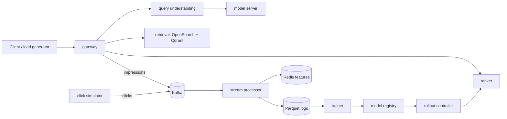

# BharatSearch Runbook

Standard operating procedure for running the BharatSearch search stack locally. Intended for a developer machine with no cloud account.

## 1. Prerequisites

| Tool | Version | Purpose |
|------|---------|---------|
| Docker | any recent | Compose stack (Kafka, OpenSearch, Qdrant, Redis, model server) |
| Python | 3.12+ | uv workspace, service apps |
| uv | any recent | Python workspace manager |
| make | any recent | Makefile targets below |

Verify:
```bash
docker --version
uv --version
make --version
python3 --version
```

## 2. Architecture

The stack runs as a Docker Compose profile (`lite`) plus two FastAPI services you start directly:



Infrastructure ports (Compose, profile `lite`):

| Service | Port | Notes |
|---------|------|-------|
| OpenSearch | 9200 | BM25 index `products` |
| Qdrant | 6333 | Dense collection `products` (384-dim cosine) |
| Redis | 6379 | Feature store |
| Kafka | 9092 | Event bus |
| model-server-lite | 8000 | Stub inference (OpenAI-compatible) |

Application services (started directly, not in Compose):

| Service | Port | Endpoint |
|---------|------|----------|
| embedding | 8001 | `POST /embed` |
| retrieval | 8002 | `POST /v1/search`, `POST /v1/impression`, `POST /v1/click` |

Frontend (served directly, port 3000):

| Page | Path | Purpose |
|------|------|---------|
| Search UI | `demo/frontend/index.html` | Search form, results table, timing strip |
| Load test | `demo/frontend/load-test.html` | Load generator against `POST /v1/search` |

## 3. Step-by-step procedure

### Step 0 — First-time setup

Clone the repository and create the environment file:

```bash
cp .env.example .env
```

Review `PROFILE` in `.env` (default: `lite`). Then set up the uv workspace:

```bash
make setup
```

This runs `uv sync --dev` and creates the virtual environment.

**Important:** The application services import workspace packages that `uv sync --dev` does not install as editable. Before starting the embedding or retrieval service, install them:

```bash
uv pip install -e libs/contracts -e libs/common
uv pip install -e services/embedding -e services/retrieval
uv pip install fastapi uvicorn prometheus-client httpx
```

You only need to do this once (or after recreating the venv).

### Step 1 — Start the infrastructure stack

```bash
make up
```

Wait for all five containers to become healthy:

```bash
docker compose --profile lite ps
```

Expected output (all `healthy`):

```
bharatsearch-kafka-1               apache/kafka:latest                   Up N minutes (healthy)
bharatsearch-model-server-lite-1   bharatsearch-model-server-lite        Up N minutes (healthy)
bharatsearch-opensearch-1          opensearchproject/opensearch:2.13.0   Up N minutes (healthy)
bharatsearch-qdrant-1              qdrant/qdrant:v1.12.0                 Up N minutes (healthy)
bharatsearch-redis-1               redis:7-alpine                        Up N minutes (healthy)
```

Verify OpenSearch is ready:

```bash
curl -s 'http://localhost:9200/_cluster/health'
# {"status":"green",...}
```

### Step 2 — Index sample data

```bash
make index
```

This deletes and recreates the OpenSearch `products` index and Qdrant `products` collection, then indexes 5 sample products (`p1`–`p5`). It is idempotent — safe to re-run.

Verify:

```bash
curl -s 'http://localhost:9200/products/_count'     # {"count":5,...}
curl -s 'http://localhost:6333/collections/products' # {"result":{"points_count":5,...}}
```

### Step 3 — Start the application services

Start the embedding service first (retrieval depends on it for dense search):

```bash
# Terminal 1
make run-embedding
```

Verify:

```bash
curl -s 'http://localhost:8001/healthz'   # ok
curl -s 'http://localhost:8001/readyz'    # ready
```

Then start the retrieval service:

```bash
# Terminal 2
make run-retrieval
```

Verify:

```bash
curl -s 'http://localhost:8002/healthz'   # ok
curl -s 'http://localhost:8002/readyz'    # ready
```

### Step 4 — Verify end-to-end search

```bash
curl -s -X POST 'http://localhost:8002/v1/search' \
  -H 'Content-Type: application/json' \
  -d '{"query":"fone cover sasta","session_id":"s1","k":10}'
```

Expected response: ranked results (`p4`, `p1`, ...), `understanding` block (corrected query, language, intent, source), and `timing_ms` (bm25, dense, fuse, total).

Serve the frontend (optional, separate terminal):

```bash
cd demo/frontend && python3 -m http.server 3000
```

Open `http://localhost:3000/` for the search UI, or `http://localhost:3000/load-test.html` for the load test simulator.

### Step 5 — Stop the stack

From the repo root:

```bash
make down
```

This stops and removes the Compose containers. To also remove named volumes:

```bash
make clean
```

## 4. Makefile targets

| Target | Purpose |
|--------|---------|
| `make setup` | Create environment (`uv sync --dev`) |
| `make up` / `make down` | Start/stop Compose stack for `$(PROFILE)` |
| `make clean` | Stop stack and remove volumes |
| `make smoke` | Run unit tests (`pytest tests/ -q`) |
| `make test` | Run tests excluding slow (`-m "not slow"`) |
| `make lint` | `ruff check .` + `ruff format --check .` |
| `make data` | Generate query variants to `data/processed/variants.json` |
| `make index` | Create OpenSearch + Qdrant indexes with sample catalog |
| `make eval` | Toy evaluation via `eval.harness` |
| `make benchmark` | BM25 vs hybrid benchmark report |
| `make run-embedding` | Start embedding service (port 8001) |
| `make run-retrieval` | Start retrieval service (port 8002) |
| `make autoscale-bench` | Forecaster backtest across all load profiles |
| `make demo` | Demo steps (requires `make up PROFILE=standard`) |

## 5. Quick verification checklist

- [ ] `docker compose --profile lite ps` — all containers healthy
- [ ] `curl http://localhost:9200/_cluster/health` — status green
- [ ] `curl http://localhost:8001/healthz` — ok
- [ ] `curl http://localhost:8002/readyz` — ready
- [ ] `POST /v1/search` returns ranked results with `understanding` and `timing_ms`
- [ ] `http://localhost:3000/` loads the search UI (HTTP 200)
- [ ] `make lint` — ruff check + format check pass
- [ ] `make test` — unit tests pass

## 6. Notes from experience

- **Port 8000 vs 8002**: The README quickstart example shows `curl ... http://localhost:8000/v1/search`, but port 8000 is the model server (stub-inference). The retrieval API that serves `/v1/search` runs on **port 8002**.
- **Editable installs**: `uv sync --dev` does not install workspace service packages as editable. Install `services/embedding` and `services/retrieval` (plus `libs/contracts`, `libs/common`) with `uv pip install -e` before running `make run-embedding` or `make run-retrieval`.
- **`make index` previously failed** with `httpx.ReadError: Connection reset by peer` when OpenSearch was not yet healthy. Always wait for OpenSearch to report `status: green` before indexing.
- **`docker-compose.yml`** has uncommitted working-tree changes (Kafka image `apache/kafka:latest` instead of `bitnami/kafka:3.9`, plus added volumes and healthcheck tweaks). The running stack is healthy with the current image; decide whether to commit or revert per your commit conventions.
- **Tests**: One pre-existing flaky test (`test_decayed_counter_decays_over_time`) fails due to wall-clock timing tolerance; not caused by any service change.

## 7. Teardown

```bash
# Stop Compose stack
make down

# (Optional) Remove volumes and images for a completely fresh start
make clean
docker rmi -f apache/kafka:latest qdrant/qdrant:v1.12.0 opensearchproject/opensearch:2.13.0 redis:7-alpine bharatsearch-model-server-lite
```

To start completely fresh on the next session, repeat from **Step 1**.